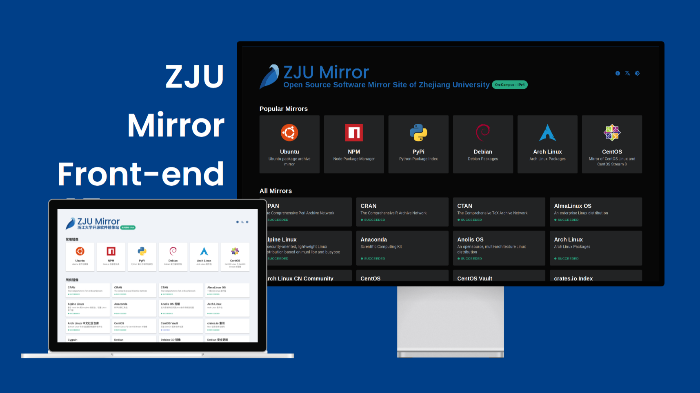

# ZJU Mirror 前端

ZJU Mirror 前端是一个使用 Astro 静态生成的网站，通过少量 React island 提供实时镜像状态、搜索和文档。后端 JSON 格式参见 [mirrorz-json](https://github.com/mirrorz-org/mirrorz#data-format-v15-draft)。

## 历史

- 2026 年 9 月：使用 GPT-5.6 重构为基于 Astro 的前端，一些约束如下：

    - 要求静态内容，不做任何服务端渲染
    - 遵守 [Material Design 2](https://m2.material.io/design/guidelines-overview) 设计规范
    - 图标使用 Google Material Icons、Iconify Logos 或 Simple Icons

    重构后的前端代码没有人工具体 Review 过。

- 2026 年 4 月前：基于 Gatsby。
- 特别感谢 UI 设计师：[Rynco Maekawa](https://github.com/lynzrand)

## 内容

### 文档

- 公告：`news/`
- 特殊页面：`src/content/special-pages/`，例如关于、历史、统计图表等页面，点击右上角的图标进入
- 镜像文档：

    - 我们没有精力为所有镜像维护文档，所以默认使用教育网联合镜像站文档 [MirrorZ Docs](https://github.com/mirrorz-org/mirrorz-docs)。
    - 我们有精力维护部分镜像的文档，放置在 `src/content/docs-overrides` 下覆盖 MirrorZ Docs 中相应的内容。

### 静态投递

活动页面等非镜像静态内容放在 `static/delivery/<活动名>/`，构建时原样复制进
前端镜像，通过 `/delivery/<活动名>/<文件名>` 访问。

### AI Agent 友好

按照 [LLMs.txt](https://llmstxt.org/) 提案：

- `/llms.txt` 提供全站索引
- `/docs/<id>.md` 和 `/<page>.md` 提供页面的 Markdown 版本

在文档页面提供两个按键：

- 复制 Markdown：点击后将静态 Markdown 文档复制到剪贴板
- 查看 Markdown：其链接指向该页面的 Markdown 版本

## 设计

- 页面宽度：为避免屏幕横向过宽导致阅读困难，对各页面内容限制最大宽度。

    - 首页和目录列表：96rem
    - 统计页面：88rem
    - 其他页面：58rem

- 主题：目前提供三种主题：

    - Material 2
    - Terraria
    - Stardew Valley

- 深色模式：默认跟随系统

- 镜像呈现：目前提供三种呈现方式：

    - 卡片
    - 表格
    - 时间轴（TODO：需要优化）

- 文件浏览：

    - `/<mirror>/<relative-directory>/` 提供 HTML Shell
    - Shell 请求 `/<mirror>/.mirror-index/<relative-directory>/` 获取 JSON 数据，要求后端返回数据格式符合 [Nginx Autoindex](https://nginx.org/en/docs/http/ngx_http_autoindex_module.html)。
    - TODO：前后端都需要优化。前端需要优化目录的呈现（例如分页、大体积 JSON 处理等），后端需要优化超大型目录的 JSON 索引生成。

## 开发

开发环境使用 Docker，具体配置见 `compose.yaml`、`Dockerfile.dev` 和 `Dockerfile`。
默认使用 Node.js 22、pnpm 10.15.1 和 npm 官方源。需要时可通过
`NPM_REGISTRY` 指定 npm 镜像，例如 `https://registry.npmmirror.com`；不设置
时 GitHub Actions 使用官方源。

```sh
export DEV_UID="$(id -u)" DEV_GID="$(id -g)"
export NPM_REGISTRY=https://registry.npmmirror.com  # 可选
docker compose build dev
docker compose run --rm dev git submodule update --init --recursive
docker compose run --rm dev pnpm install --frozen-lockfile
docker compose run --rm --service-ports dev
```

开发服务器监听 `0.0.0.0:4321`。检查、格式化和本地 fixture 预览使用同一个
容器：

```sh
docker compose run --rm dev pnpm check
docker compose run --rm dev pnpm format
docker compose run --rm --service-ports dev pnpm dev:review
```

构建生产镜像或启动预览：

```sh
docker build --tag mirror-front .
docker compose up --detach --build preview
```

开发服务只持久化 `node_modules` 和 pnpm store；`.astro`、`.cache` 与 `dist`
使用临时文件系统。运行 `docker compose down --volumes` 可删除命名缓存。

## CI

CI 会构建两个镜像。前端构建运行 Astro/TypeScript 检查，exporter 构建运行两个针对性的测试。推送到 `main` 后，CI 还会将两个 GHCR 镜像发布为 `latest` 和七字符提交缩写标签。镜像清理会保留最新的十个提交标签，并删除不再需要的无标签镜像。

另一个工作流会检查并打包 `charts/mirror-front/` 下的变更，并在推送到 `main` 时发布 OCI chart。版本使用 `Chart.yaml` 中的值，不需要 Git release tag。只有 chart 的变更不会触发镜像构建。
